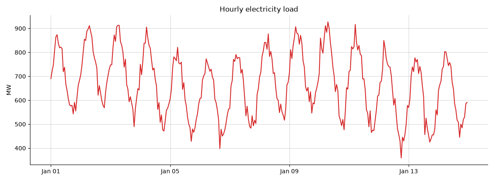
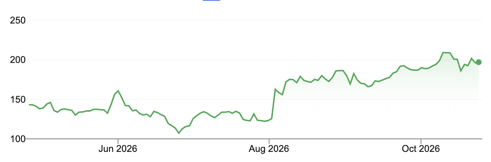
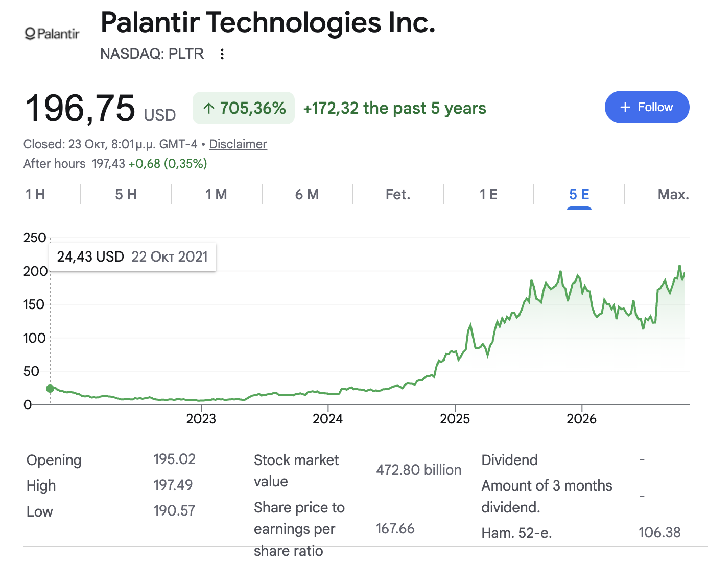

# chartcast

Turn a picture of a time series chart back into data, forecast it, and compute, with rolling forecast validation, a
mean error baseline and the probability that the forecast is incorrect.

You give it a screenshot of a line chart (a stock price, energy load, sales, anything with a value axis and a time
axis). It reads the axes with OCR, traces the line, rebuilds the series, and runs a rolling validation on the
chart's own history to measure how well each forecasting model would have done.

## Demo

Two recordings of the app running locally on the same chart: a narrated presentation and a silent walkthrough with
captions. Both play directly on this page.

### Presentation (5:11, with narration)

I walk through the app step by step and explain what it does, from uploading a chart and checking its reconstruction
to the forecast, the mean error baseline and the probability that the forecast is incorrect.

https://github.com/user-attachments/assets/b484aa4d-377a-4872-99fc-83c9dffa4382

### Silent walkthrough (2:41, with captions)

The same flow without sound, from upload to forecast, with on-screen captions describing each step and the results.

https://github.com/user-attachments/assets/b7e904fc-d997-4684-bb16-d59e0ef44b70

Both videos are also in [`demo/`](demo) for download.

## What it reads

Any line chart with readable labels on both axes, from three kinds of source.

**Synthetic charts**, generated with known data and used to measure accuracy:



**Real charts, plot only**, e.g. a cropped screenshot of a chart:



**Real screenshots from the web**, with the page around the chart. Everything that is not the chart (title, prices,
buttons, tables, side panels) is ignored and only the time series is kept:



## Test samples

The test charts live in `samples/` and appear in the app's sample gallery:

- `samples/real/`: real chart screenshots (stock and index charts, daily, intraday and multi-year, plot-only and full
  web pages).
- `samples/synthetic/`: generated charts (energy, sales, stock price, temperature, website visits, long-term growth
  on a log scale). Each image has a `.json` file next to it with the true data it was drawn from, which the app uses
  to show the extraction error.

## Setup

Tested with Python 3.12.

```bash
git clone https://github.com/IgnatiosDalampekis/chartcast.git
cd chartcast
python3.12 -m venv .venv
source .venv/bin/activate
pip install -r requirements.txt
streamlit run app.py
```

On first run EasyOCR downloads its models (~100 MB) into `.models/`.

## Using the app

1. Pick one of the test charts or upload your own.
2. Check the reconstruction: the original next to a redraw of what was read (axes, labels, line). For the
   synthetic samples the true data is drawn on top of the extracted series, so you can see the error. Click any
   picture to see it larger.
   Under it, *Extraction details / Download CSV* (closed by default) shows what was detected on the image (plot
   area, axis labels, axis lines, traced line), the checks of each step (labels used, calibration fit, any
   corrected labels, how the sampling was found), and a button to download the extracted series as CSV.
3. Look at the overview: sampling, number of points, time range, value range, change, scale.
4. Choose a model and three settings: how far ahead to forecast, how much history to train on and how far the
   training window moves between validation runs. Each is set as an amount plus a unit (minutes, hours, days,
   weeks, months or years), e.g. "forecast the next 2 weeks, train on the last 6 months". Only units the chart's
   sampling can support are offered (no minutes for a daily chart). Sensible defaults are filled in; the demos use
   them as they are.
5. Run it. You get the forecast as a continuation of the line, the mean error baseline, and a table with, for each
   future step, the forecast value and the probability that it misses by more than your tolerance (with its 95%
   interval). The forecast can be downloaded as CSV. When models are compared, a second table shows each model's
   mean error baseline and P(incorrect).

## How it works

The pipeline has two halves: extraction (image → time series) and forecasting (time series → forecast and error
probability).

```
image ─► read text (OCR) ─► find axes ─► calibrate pixels ─► trace the line ─► find the sampling ─► series
series ─► rolling validation per model ─► pick a model ─► forecast + mean error + P(incorrect)
```

**1. Reading the chart.** The axes are found from their labels rather than from drawn lines, because labels are the
one thing every readable chart has. OCR reads all the text in the image; the value axis is the column of numbers
that increases upwards and sits on a single scale, the time axis is the row of dates that increases to the right.
Stray text (titles, prices, buttons, tables) fails these checks and is ignored. The two label strips are then read
a second time, enlarged, to recover small or misread labels.

**2. Calibration.** A robust line fit through the labels maps every pixel to a value and a timestamp, so points
between labels are interpolated exactly (with labels 100 at row 400 and 200 at row 300, row 350 is 150). Axes are
linear unless the labels fit a log scale clearly better (e.g. 10, 100, 1000 evenly spaced) or the chart says "log".

**3. Tracing.** The line is separated from gridlines, text and shading by colour, thinned to a one-pixel
centreline and read column by column. This gives one value per pixel column, which is a drawing, not yet the data.

**4. Sampling.** A chart is drawn from a table of measurements taken at regular times (one value per day, per hour,
per month…): the plotting software puts a point for each measurement and joins them with straight segments. So the
traced line turns at every data point, and those turns are evenly spaced in pixels. To find that spacing we take the
second difference of the trace (large where the line changes direction) and run an FFT on it: evenly spaced corners
give a sharp peak at one spacing, while pixel noise spreads out. Spacing in pixels × time per pixel (from the time
axis) = time between measurements, snapped to the nearest standard step (5 minutes, hourly, daily, weekly, monthly,
…). When the points are too dense for corners to be visible, the finest step the plot width can show is used. The
trace is then resampled to exactly one value per step, which recovers the number of data points the chart was drawn
from instead of one per pixel.

Knowing the real sampling step is also what makes the forecast settings understandable. Since one sample is a known
amount of time, the user can set the horizon, the training window and the validation step in minutes, hours, days,
weeks, months or years, and the app converts them to samples (on a daily chart, "2 weeks" = 14 samples). Without it
the only option would be a count of points, which means nothing to someone looking at a picture of a chart.

**5. Forecasting.** Four models: naive, seasonal naive, Holt-Winters and ARIMA. Each is validated by sliding a fixed
training window back through the history; at every position it forecasts the horizon and is compared with what the
chart actually shows. *Auto* picks the model with the lowest mean error; you can also pick the one with the lowest
probability of being wrong, or fix a model.

With `e(k, h) = |actual − forecast| / |actual|` for validation run `k` at `h` steps ahead:

```
mean error baseline = average of e(k, h) over all runs and steps
P(incorrect | h)    = share of runs with e(k, h) > tolerance
```

P(incorrect) is shown with a 95% Wilson interval, since it is estimated from a limited number of runs.

The whole pipeline is deterministic: the same image and settings always give the same result.

## Project layout

```
app.py               Streamlit app
chartcast/
  preprocess.py      image normalisation and ink masks
  ocr.py             text reading (EasyOCR)
  parse.py           label text -> numbers and dates
  axes.py            axis detection and plot area
  calibrate.py       pixel -> value / time
  line.py, trace.py  line isolation, tracing, resampling
  pipeline.py        image -> series, plus the drawings shown in the app
  forecast.py        models and rolling validation
  uncertainty.py     P(incorrect) and intervals
  synth.py           synthetic test charts with known data
samples/             real screenshots and synthetic charts (with their true data)
demo/                demo videos
tests/
```

## Tests

```bash
pytest               # everything, ~1 min
pytest -m "not ocr"  # unit tests only, a few seconds
```

The end-to-end tests generate synthetic charts with known data and check the extraction against it. On those charts
the series comes out within about 1.5% of the value range (median), axes and plot area are found on all of them, and
the sampling frequency is right on 18 of 20.

New synthetic charts can be generated with `python -m chartcast.synth --n 6 --out samples/synthetic`.

## Limitations

- Line charts only; no bars, candlesticks or overlapping lines of the same colour.
- The chart needs readable tick labels on both axes.
- The relative error is unstable for values close to zero.
- Validation runs overlap, so the intervals on P(incorrect) are somewhat optimistic.
